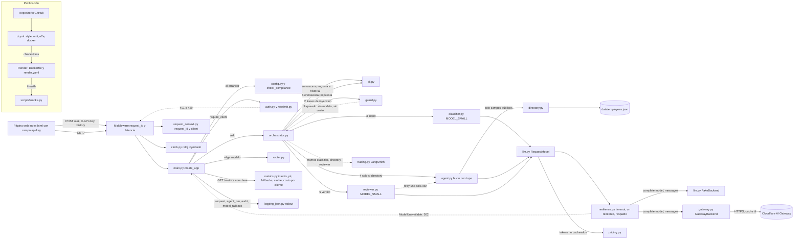

# Arquitectura del HR Assistant

API FastAPI sin estado, tres agentes por pregunta con herramientas de solo lectura y un modelo detrás de una interfaz.
La sesión 2 agrega observabilidad: id por petición, log JSON, métricas por proceso y trazas opcionales.
La sesión 3 agrega el modelo real por AI Gateway (que le enseña el protocolo al modelo), enrutamiento, ventana de
historial, tope de salida, caché y costo por respuesta.
La sesión 4 agrega clave por cliente, límite de peticiones, compliance como código, contenedor, CI y Render.
La sesión 5 agrega el enmascarado de PII, el filtro de inyección, el clasificador, el revisor, mínimo privilegio en los
datos y resiliencia hacia el modelo (reintento y respaldo).
Decisiones en `adr/`.

## Módulos

- `config.py`: variables de entorno validadas, incluidas observabilidad, costos, producción y resiliencia; `check_compliance`.
- `auth.py` y `ratelimit.py`: clave por cliente y ventana deslizante de 60 s.
- `pii.py`: detección y enmascarado de correo, teléfono, CURP, RFC y tarjeta con expresiones regulares.
- `guard.py`: lista fija de frases de inyección de prompts; bloquea antes de cualquier modelo.
- `orchestrator.py`: filtro, enmascarado, clasificador, directorio, revisor y mensajes exactos del contrato.
- `classifier.py` y `reviewer.py`: agentes pequeños; el código valida su JSON.
- `directory.py`: lectura de empleados, solo con campos públicos.
- `router.py`: regla en código que elige el modelo y recorta el historial.
- `pricing.py`: precios por modelo y costo en USD.
- `resilience.py`: timeout, un reintento, respaldo a `MODEL_SMALL` y evento `model_fallback`.
- `gateway.py`: llamada a AI Gateway, mensaje de sistema, extracción tolerante del JSON, caché y errores tipificados.
- `llm.py`: interfaz del modelo, modelo simulado (también clasifica y revisa) y `RequestModel` por agente.
- `agent.py`: bucle de herramientas con tope.
- `clock.py`, `request_context.py`, `logging_json.py`, `metrics.py`, `tracing.py`: observabilidad inyectable.
- `main.py`: rutas, middleware, dependencia de autenticación y ensamblado de dependencias.
- `static/index.html`: interfaz para el personal de RH, con campo de clave en `sessionStorage` y el `request_id` visible.
