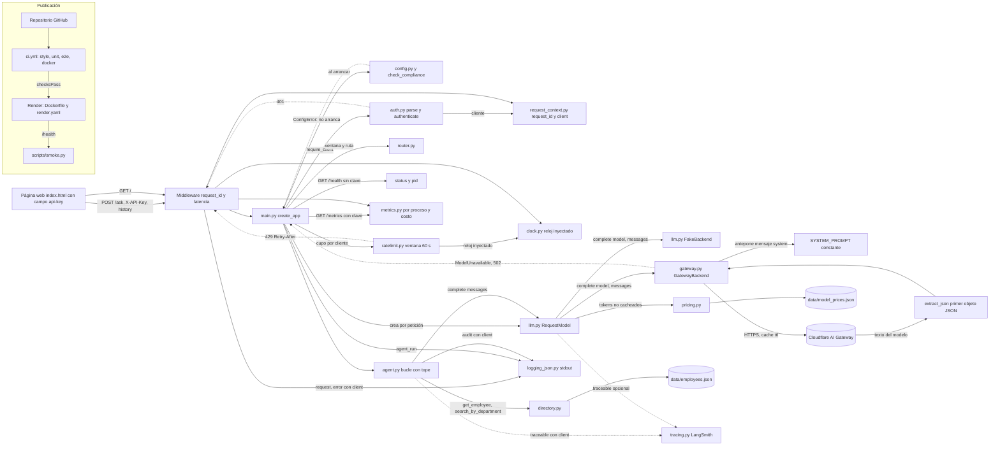

# Arquitectura del HR Assistant

API FastAPI sin estado, un agente con dos herramientas de solo lectura y un modelo detrás de una interfaz.
La sesión 2 agrega observabilidad: id por petición, log JSON, métricas por proceso y trazas opcionales.
La sesión 3 agrega el modelo real por AI Gateway (que le enseña el protocolo al modelo), enrutamiento, ventana de
historial, tope de salida, caché y costo por respuesta.
La sesión 4 agrega clave por cliente, límite de peticiones, compliance como código, contenedor, CI y Render.
Decisiones en `adr/`.

## Módulos

- `config.py`: variables de entorno validadas, incluidas las de observabilidad, costos y producción; `check_compliance`.
- `auth.py`: lectura de `API_KEYS` y autenticación por cliente, sin escribir nunca la clave.
- `ratelimit.py`: ventana deslizante de 60 s por cliente con el reloj inyectado.
- `directory.py`: lectura de empleados.
- `router.py`: regla en código que elige el modelo y recorta el historial.
- `pricing.py`: precios por modelo y costo en USD.
- `gateway.py`: llamada a AI Gateway, mensaje de sistema, extracción tolerante del JSON, caché y errores como `ModelUnavailable`.
- `llm.py`: interfaz del modelo, modelo simulado y `RequestModel` por petición.
- `agent.py`: bucle de herramientas con tope; informa `stopped` y herramientas con argumentos.
- `clock.py`: reloj inyectado para hora y latencias.
- `request_context.py`: id de la petición y cliente en `ContextVar`.
- `logging_json.py`: una línea JSON por evento, con `client` si existe, sin texto de preguntas ni respuestas.
- `metrics.py`: contadores, p50, p95, SLO y costo acumulado del proceso.
- `tracing.py`: trazas de LangSmith, apagadas sin clave, con el cliente en los metadatos.
- `main.py`: rutas, middleware, dependencia de autenticación y ensamblado de dependencias.
- `static/index.html`: interfaz para el personal de RH, con campo de clave en `sessionStorage` y el `request_id` visible.
